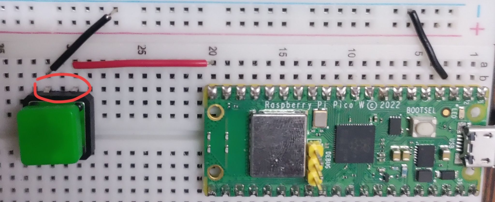
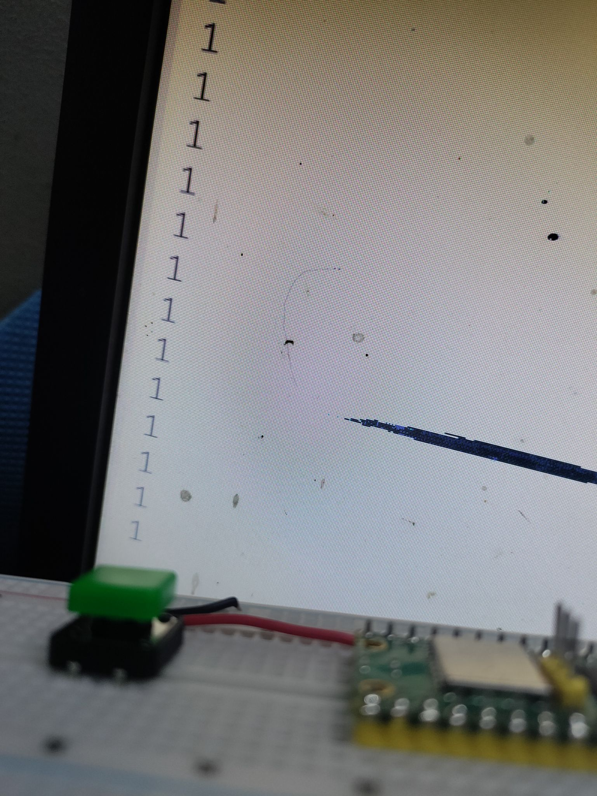
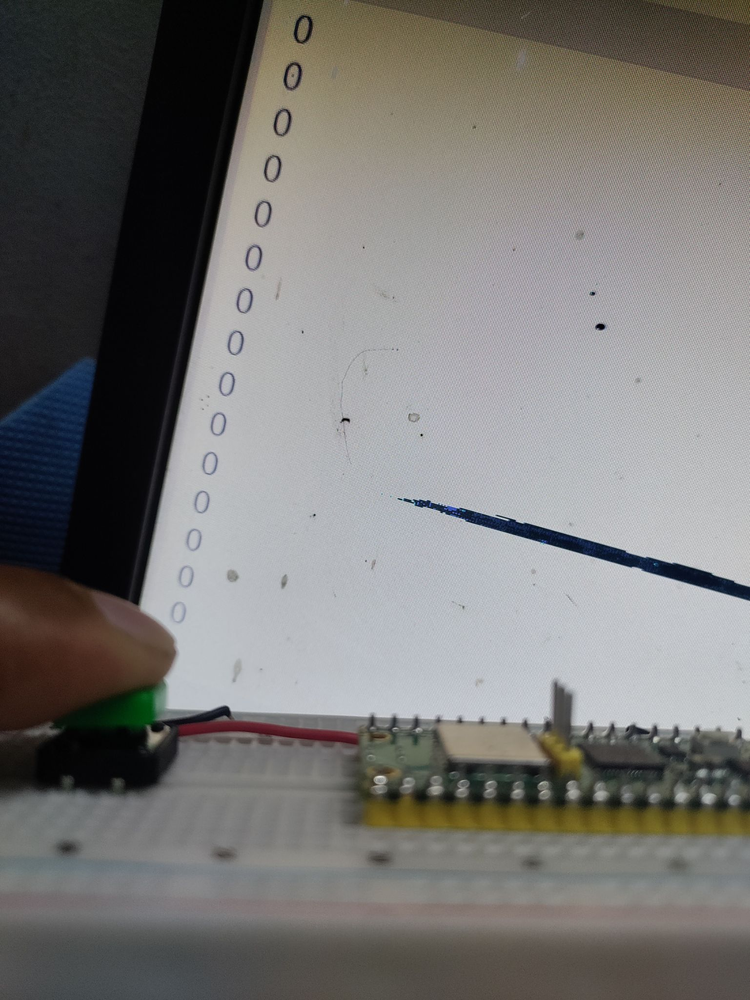

  
```python
from machine import Pin
from time import sleep

buttonPin = 15;
myButton = Pin(buttonPin, Pin.IN, Pin.PULL_UP)

while True:
    buttonState = myButton.value()
    print(buttonState)
    sleep(0.1)
```  
  
  
