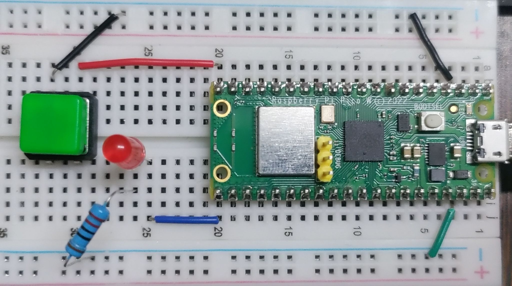
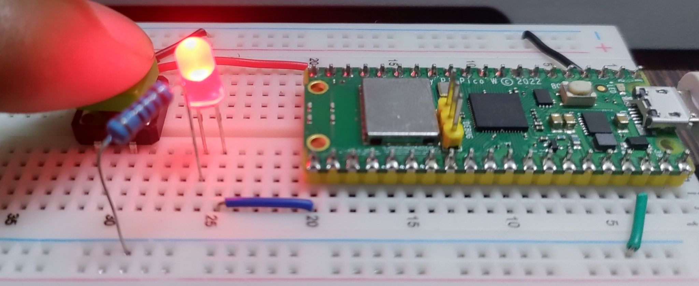

  
```python
from machine import Pin
from time import sleep

buttonPin = 15;
myButton = Pin(buttonPin, Pin.IN, Pin.PULL_UP)
myLed = Pin(16, Pin.OUT)


while True:
    buttonState = not myButton.value()
    print(buttonState)
    myLed.value(buttonState)
    sleep(0.1)
```  
  