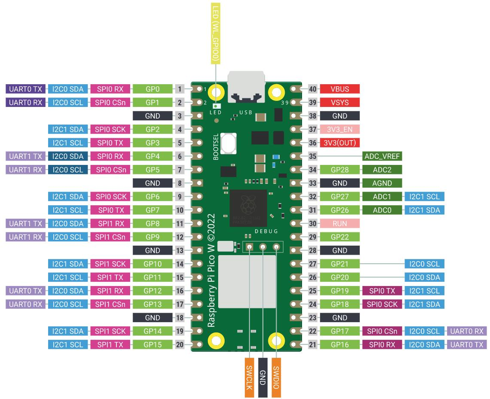
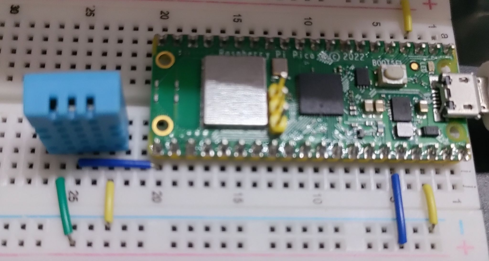

##### Pin diagram:  
  
##### Pin diagram:  
  
```python
from machine import Pin
from time import sleep
from dht import DHT11

dataPin = 16 # DHT11 2nd from left => GPIO16
myPin = Pin(dataPin, Pin.OUT, Pin.PULL_DOWN)
sensor = DHT11(myPin)

while True:
    sensor.measure()
    tempInC = sensor.temperature()
    humidity = sensor.humidity()
    print(f"Temperature: {tempInC}C | Humidity: {humidity}%")
    sleep(2)
```  
#### Output:  
```
Temperature: 34C | Humidity: 43%
Temperature: 34C | Humidity: 43%
Temperature: 34C | Humidity: 42%
Temperature: 34C | Humidity: 42%
Temperature: 34C | Humidity: 41%
```  