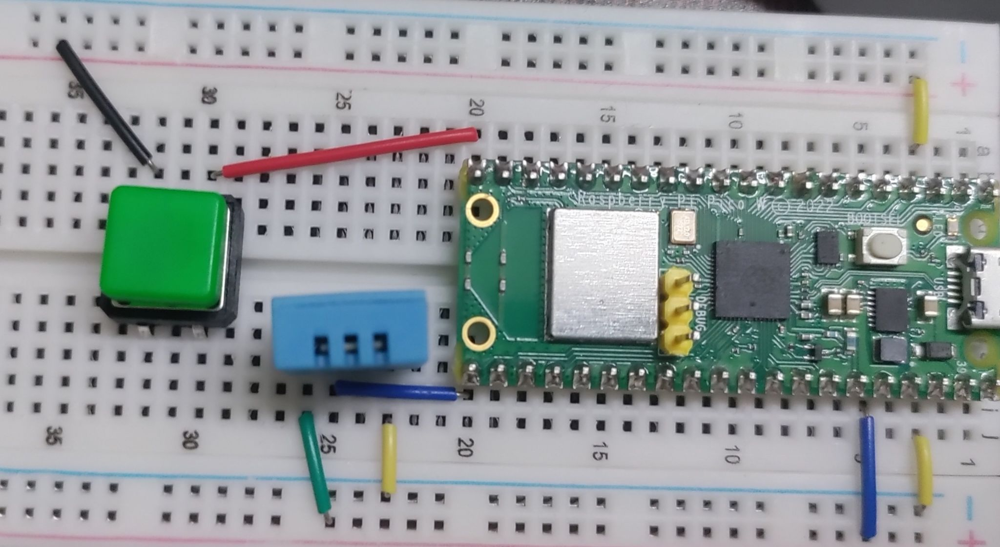

  
```python
from machine import Pin
from time import sleep
from dht import DHT11

dataPin = 16 
myPin = Pin(dataPin, Pin.OUT, Pin.PULL_DOWN)
sensor = DHT11(myPin)

buttonPin = 15
myButton = Pin(buttonPin, Pin.IN, Pin.PULL_UP)

show_fahrenheit = False 
last_button_state = False 

while True:
    current_button_state = not myButton.value()
    
    if current_button_state and not last_button_state:
        show_fahrenheit = not show_fahrenheit 
        
    last_button_state = current_button_state 
    
    sensor.measure()
    tempInC = sensor.temperature()
    
    if show_fahrenheit:
        tempInF = (tempInC * 1.8) + 32
        print(f"Temperature: {tempInF}°F")
    else:
        print(f"Temperature: {tempInC}°C")

    sleep(1)
```  