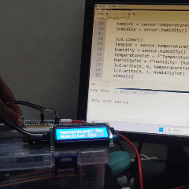

```python
from lcd1602 import LCD
from machine import Pin
from dht import DHT11
from time import sleep

lcd = LCD() # we hardcoded GP6 & GP7 as default pin into lcd1602.py file

dataPin = 16 # DHT11 2nd from left => GPIO16
myPin = Pin(dataPin, Pin.OUT, Pin.PULL_DOWN)
sensor = DHT11(myPin)

while True:
  
    sensor.measure()
    tempInC = sensor.temperature()
    humidity = sensor.humidity()

    lcd.clear()
    tempInC = sensor.temperature()
    humidity = sensor.humidity()
    temperatureTxt = f"Temperature: {tempInC}c"
    HumidityTxt = f"Humidity: {humidity}%"
    lcd.write(0, 0, temperatureTxt)
    lcd.write(0, 1, HumidityTxt)
    sleep(1)
```  
  