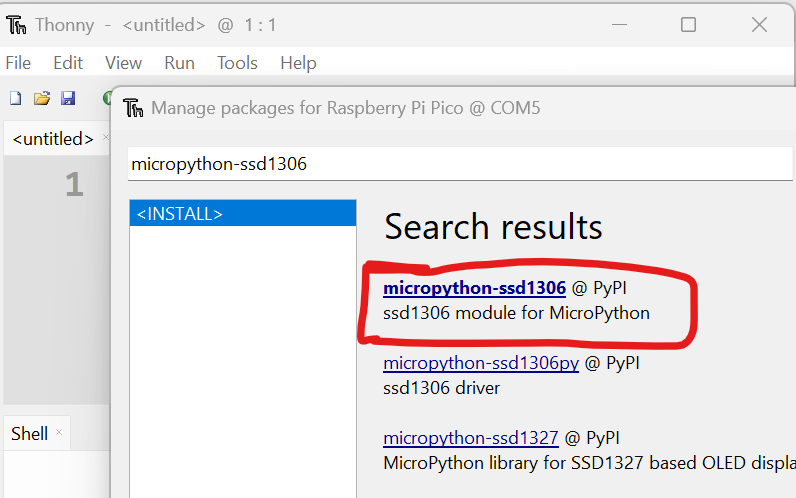
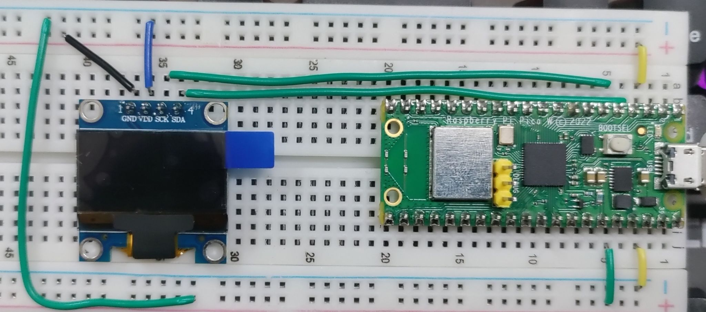
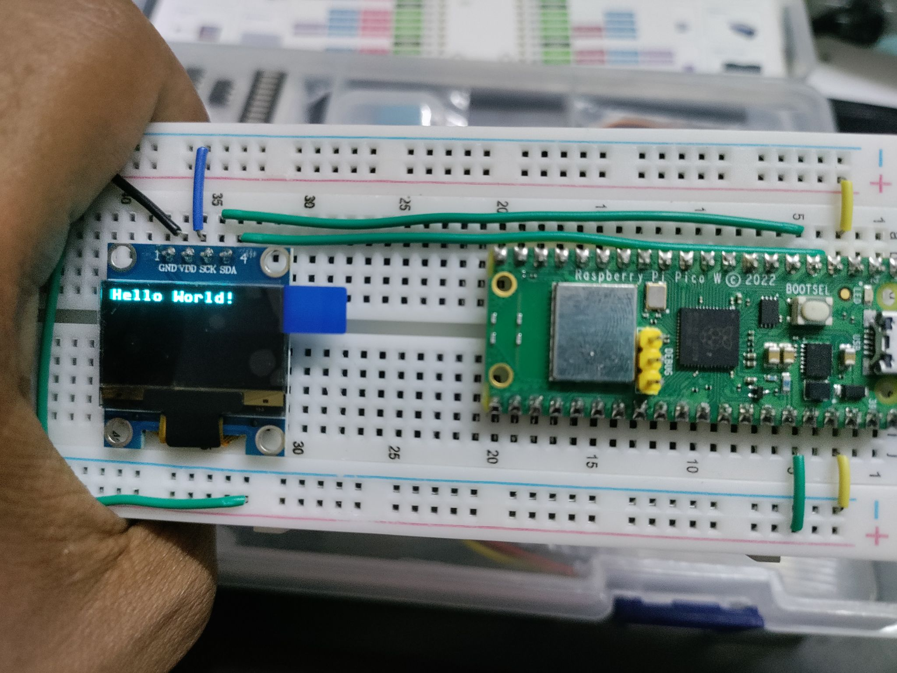

##### Install micro python library:  
`Tools` => `Manage Packages` 
  
  
```python
from machine import Pin, I2C
from ssd1306 import SSD1306_I2C
import time

i2c = I2C(1, sda=Pin(2), scl=Pin(3), freq=400000)
dsp = SSD1306_I2C(128, 64, i2c)
msg = 'Hello World!'
dsp.text(msg, 0, 0)
dsp.show()
```  
  

useful methods
```python
# Invert color
dsp.invert(1)

# Draw Horizontal Line
dsp.hline(20,20,40,1)
# Draw Vertical Line
dsp.vline(20,20,40,1)
# Draw Random Line
dsp.line(20, 20, 118, 54, 1)

# Draw Rectangle
dsp.rect(45, 25, 30, 20, 1)
# Draw Filled Rectangle
dsp.rect(45, 25, 30, 20, 1)


```  