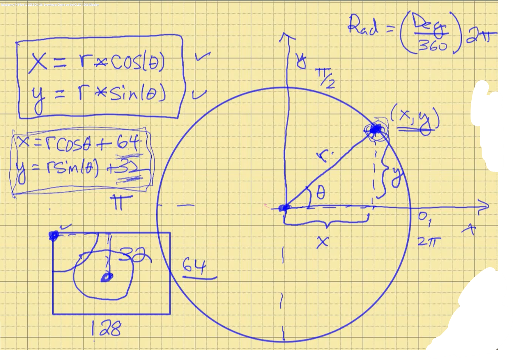

  

```python
from machine import Pin, I2C
from ssd1306 import SSD1306_I2C
import math 

myConfig = I2C(1, sda=Pin(2), scl=Pin(3), freq=400000)
display = SSD1306_I2C(128, 64, myConfig)

radius = 20; # radius = 20px
horizontalCenterX = 64 	# led display is 128 wide / 2 = 64
verticalCenterY = 32		# led display is 064 wide / 2 = 32
pie = 3.14
supportRadFormulae = 2 * pie / 360

for degree in range (0, 360, 1):
    radians = degree * supportRadFormulae
    x = radius * math.cos(radians) + horizontalCenterX
    y = radius * math.sin(radians) + verticalCenterY
    display.pixel(int(x), int(y), 1)
    display.show()
```  
<video src="../0_images/002/08.mp4" controls width="640"></video>
